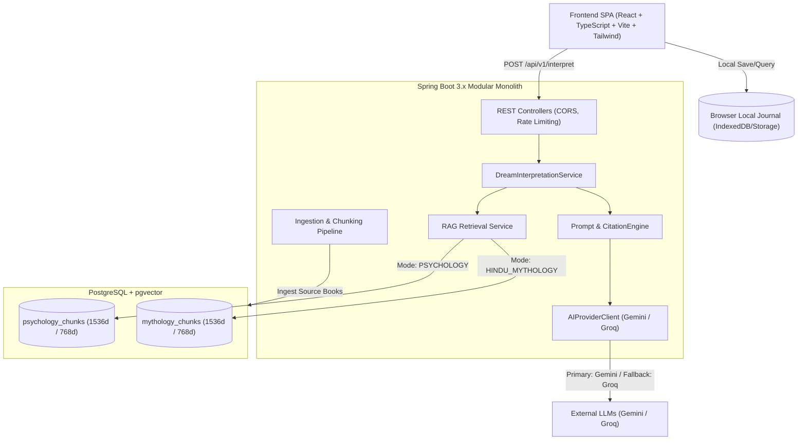

# DreamLens 2.0 — System Architecture

## 1. Architectural Overview
DreamLens 2.0 is designed as a **Modular Monolith** backend in Java/Spring Boot paired with a responsive, client-side SPA in React/TypeScript/Vite. The system utilizes PostgreSQL with `pgvector` for dual-collection knowledge retrieval, and an abstraction layer for Gemini and Groq AI providers.



## 2. Frontend Architecture
- **Framework:** React 18 / Vite with TypeScript.
- **Styling & Design System:** Tailwind CSS with custom theme extensions for the two distinct visual worlds.
- **State Management:** Zustand or React Context for interpretation session state (preserving dream text across mode switches).
- **Client Persistence:** Dexie.js / IndexedDB wrapper for the private, device-local dream journal.
- **Animation & Transitions:** Tailwind CSS transitions and Framer Motion for cinematic world transitions and loading sequences.

## 3. Backend Architecture (Spring Boot Modular Monolith)
### Directory & Package Structure:
```
backend/
├── src/main/java/com/dreamlens/
│   ├── DreamLensApplication.java
│   ├── config/                  # Security, CORS, AI client configuration
│   ├── controller/              # REST Endpoints
│   │   ├── InterpretationController.java
│   │   ├── IngestionController.java (Admin/Dev)
│   │   └── HealthController.java
│   ├── dto/                     # Request and Response DTOs
│   │   ├── DreamRequest.java
│   │   ├── InterpretationResponse.java
│   │   └── CitationDto.java
│   ├── model/                   # Domain entities for knowledge chunks
│   │   ├── DocumentMetadata.java
│   │   └── KnowledgeChunk.java
│   ├── service/
│   │   ├── InterpretationService.java
│   │   ├── ai/                  # AI Provider Abstraction
│   │   │   ├── AIService.java
│   │   │   ├── GeminiProvider.java
│   │   │   └── GroqProvider.java
│   │   ├── rag/                 # Retrieval Augmented Generation
│   │   │   ├── VectorSearchService.java
│   │   │   └── EmbeddingService.java
│   │   └── ingestion/           # Document Ingestion Pipeline
│   │       ├── DocumentIngestionService.java
│   │       ├── PdfTextExtractor.java
│   │       └── TextChunker.java
│   └── repository/              # Spring Data JPA / pgvector repositories
│       └── KnowledgeChunkRepository.java
```

## 4. Database Schema (PostgreSQL + pgvector)
```sql
CREATE EXTENSION IF NOT EXISTS vector;

-- Table for knowledge chunks
CREATE TABLE knowledge_chunks (
    id UUID PRIMARY KEY DEFAULT gen_random_uuid(),
    collection_type VARCHAR(32) NOT NULL, -- 'PSYCHOLOGY' or 'HINDU_MYTHOLOGY'
    source_title VARCHAR(255) NOT NULL,
    author VARCHAR(255),
    publication_year INT,
    chapter VARCHAR(255),
    printed_page INT,
    pdf_page INT,
    source_url TEXT,
    chunk_index INT NOT NULL,
    chunk_text TEXT NOT NULL,
    embedding vector(768), -- Dimensions matching selected embedding model
    created_at TIMESTAMP WITH TIME ZONE DEFAULT CURRENT_TIMESTAMP
);

CREATE INDEX idx_chunks_collection ON knowledge_chunks(collection_type);
CREATE INDEX idx_chunks_embedding ON knowledge_chunks USING hnsw (embedding vector_cosine_ops);
```
*Note: No user tables or saved dream tables exist in the backend.*

## 5. API Contracts

### `POST /api/v1/interpret`
#### Request:
```json
{
  "dreamText": "I was standing in front of a raging ocean while holding a brass lamp, then suddenly the tide turned into flower petals.",
  "mode": "HINDU_MYTHOLOGY", // or "PSYCHOLOGY"
  "inputLanguage": "ENGLISH", // "ENGLISH" | "TAMIL" | "TANGLISH"
  "responseLanguage": "TANGLISH", // "ENGLISH" | "TAMIL" | "TANGLISH"
  "emotionalState": "Anxious then peaceful",
  "additionalContext": "Woke up early morning before dawn."
}
```
#### Response:
```json
{
  "mode": "HINDU_MYTHOLOGY",
  "responseLanguage": "TANGLISH",
  "overview": "...",
  "symbolicSignificance": [
    { "symbol": "Ocean", "meaning": "..." },
    { "symbol": "Deepa (Brass Lamp)", "meaning": "..." }
  ],
  "interpretation": "...",
  "scripturalPassages": [
    {
      "source": "Agni Purana",
      "chapter": "Chapter 229",
      "page": "Page 567",
      "passage": "..."
    }
  ],
  "culturalContext": "...",
  "reflectionQuestions": [],
  "citations": [
    {
      "sourceTitle": "Agni Purana",
      "author": "Traditional",
      "chapter": "229",
      "page": 567,
      "relevance": "Direct auspicious dream omens regarding lamps and blossoms"
    }
  ],
  "processingTimeMs": 1420
}
```

## 6. AI Provider Strategy (Gemini & Groq)
- **Primary AI Provider:** Google Gemini (Gemini 1.5 Flash / Pro) via official Gemini SDK or HTTP REST client.
- **Fallback AI Provider:** Groq (Llama 3.3 70B Versatile) with sub-second generation speeds.
- **Embeddings:** Consistent embedding dimension (e.g. `text-embedding-004` 768-dim, or local HuggingFace / Gemini embeddings).
- **Resilience:** Circuit breaker pattern; automatic fallback to Groq if Gemini hits rate limits or latency thresholds.
